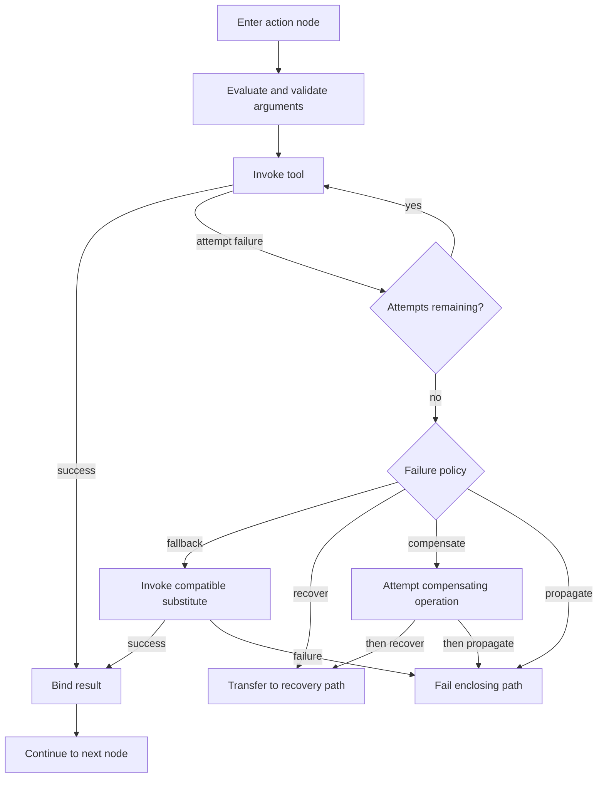

# Toolring Protocol Specification

Status: early draft. This document defines Toolring independently from Instruct.
It is not a claim of conformance by the reference implementation.

The key words **MUST**, **MUST NOT**, **SHOULD**, **SHOULD NOT**, and **MAY** are
to be interpreted as normative requirements. Toolring can be used on its own or
composed with [Instruct](./spec.md).

## 1 Purpose

Toolring is a DSL for advanced tool calling. It lets a producer, including a model,
describe a complete high-level operation containing multiple tool calls and
control-flow decisions,
instead of requiring the repeated sequence:

```text
model response -> tool call -> model response -> tool call -> ...
```

Reducing round trips preserves execution continuity and reduces the number of times
sensitive context must be exposed to a model. Toolring supports sequencing, nested
execution, branching, bounded iteration, parallel branches, retries, fallback,
recovery, and compensation.

Toolring is deliberately strict. A Toolring executor accepts a valid Toolring
program or rejects it. It does not repair tool names, infer missing control flow,
reinterpret malformed arguments, or guess what its producer meant.

This strictness makes Toolring portable, independently testable, and useful to
producers other than models. An Instruct host MAY place a lenient interpretation
layer in front of Toolring, but that layer is not part of Toolring.

## 2 Representation and validation

A Toolring program has one normative abstract structure and strict semantics. A
conforming executor MUST validate that structure before execution and MUST reject
invalid input. A concrete syntax or interchange profile MAY encode that structure
as JSON, YAML, CBOR, or another representation; no syntax changes its semantics.

Other systems MAY compile their own languages or proposals into Toolring. Instruct,
for example, can compile a lenient model-facing instruction proposal into a strict
Toolring program. Such source languages, compilers, repairs, and interpretation
decisions belong to those systems and are outside the Toolring protocol.

Two Toolring programs that are compared or protected by a digest require an agreed
semantic comparison or canonicalization profile. Map member order is not semantic.
Canonicalization does not make an invalid program valid and does not perform intent
resolution.

## 3 Program graph

A Toolring program contains:

- a Toolring version;
- one entry node;
- a map of unique node identifiers to nodes; and
- any strict execution limits required by the program.

A host or integration profile MAY attach authority and effect declarations. They
are not interpreted as security grants by Toolring itself.

Every control-flow target MUST name an existing node. Every node reachable through
normal flow, branches, loop bodies, recovery, or compensation is part of static
analysis. Unreachable nodes SHOULD produce a diagnostic and MAY be rejected by a
strict host.

The initial environment contains the program's inputs. Nodes MAY bind
outputs to names. Reading an unknown binding MUST fail before the consuming
operation is invoked.

## 4 Value expressions

A value expression is one of:

- a literal value;
- a reference to a named value; or
- a template or other explicitly defined transform over values.

Toolring preserves values according to its value model but does not define
sensitivity or disclosure policy. An integration such as Instruct MAY associate
opaque security metadata with values and define propagation rules for expressions.

Evaluation of expressions MUST be side-effect-free.

## 5 Node semantics

### 5.1 Tool node

A tool node names a tool, provides argument expressions, optionally binds its
result, and selects a successor.

Before invocation, the host MUST:

1. resolve and evaluate every argument;
2. validate the tool's input contract; and
3. charge the applicable Toolring execution limits.

The tool result is bound before execution proceeds. Toolring does not itself decide
whether a caller is authorized to invoke a tool; that is the responsibility of the
host or an integration protocol such as Instruct.

### 5.2 Condition node

A condition node evaluates a side-effect-free predicate and selects exactly one of
two targets.

The core comparison set includes equality, inequality, existence, truthiness, and
ordered comparison. Profiles MAY add operators only with explicit semantics.

### 5.3 Loop node

A loop node evaluates a finite collection, binds each item, executes its body, and
then continues to an `after` target. Every loop MUST declare a positive maximum
iteration count. Execution MUST fail or follow a configured recovery
path if the collection exceeds that bound.

### 5.4 Parallel node and join

A parallel node starts two or more logical branches and names a join point. A host
MAY schedule branches concurrently or deterministically in sequence; observable
semantics MUST NOT depend on scheduling unless the profile explicitly permits it.

Branches MUST NOT create conflicting bindings at the join. Conflicting writes MUST
be rejected statically when detectable and otherwise fail at runtime. Hosts MUST
reject unsafe combinations of irreversible effects whose ordering or duplication
could change the outcome.

A join continues only after every required branch completes successfully or its
failure has been handled.

### 5.5 Terminal node

A terminal node evaluates named result expressions and ends its current execution
path. Toolring returns the resulting values without defining their disclosure
policy. An Instruct host independently derives their guarded and remote-safe
representations.

## 6 Failure handling

Toolring distinguishes an **attempt failure** from an unhandled **path failure**.
Operations MUST expose stable error codes suitable for programmatic control. A
security integration such as Instruct is responsible for sanitizing error details
before disclosure.

An action MAY define a failure policy containing:

- **retry**: repeat the same action up to a finite total attempt count;
- **fallback**: try a different operation intended to produce a compatible result;
- **recover**: transfer control to a named recovery path;
- **compensate**: attempt to mitigate effects already produced; and
- **propagate**: fail the enclosing path.

Retries MUST be bounded. Each attempt consumes budgets and MAY produce effects.
Hosts SHOULD restrict retries of non-idempotent or irreversible operations unless
the tool declares an idempotency mechanism or safe retry contract.

Fallback and recovery are not synonyms. A fallback substitutes another means of
performing the failed operation. Recovery handles the failure and may return a
degraded result, skip work, or terminate deliberately.

Compensation is not rollback. It is a separate effectful operation that MAY fail.
A Toolring executor MUST preserve the outcome of both the original operation and
the compensation attempt. An integration MAY additionally require separate
authorization. Compensation MUST NOT erase evidence that an effect occurred.

If all configured handling is exhausted, failure propagates to the enclosing path.
An unhandled failure at the root produces a failed run.

#### Toolring action and failure flow



Retry repeats the same action. Fallback substitutes another action, recovery moves
control to another path, and compensation attempts to mitigate an already produced
effect; none of these terms are interchangeable.

## 7 Nesting

A node or tool MAY invoke a child Toolring program only when the host explicitly
supports nested execution. Nesting increments call depth and receives a portion of
the parent's remaining execution limits.

The parent MUST define how child outputs are bound and how child failures propagate.
Cycles caused by nesting are permitted only under an independently enforced finite
depth and execution budget.

## 8 Cancellation and termination

The host MAY cancel a run because of caller cancellation, policy change, budget
exhaustion, shutdown, or safety enforcement. Tools and child executions SHOULD
receive cancellation signals and SHOULD stop promptly.

Cancellation does not imply rollback. The host MUST preserve observed effects and
MAY invoke explicitly declared compensation when policy and remaining budget allow.

A Toolring program terminates when its root path reaches a terminal node, suffers
an unhandled failure, or is cancelled. Invalid Toolring input is rejected before
execution. Authorization denial, when applicable, belongs to the integrating host.
Infinite implicit waiting is not valid execution behavior.

## 9 Static analysis

Before execution, a conforming Toolring host MUST reject a program with:

- a missing entry or control-flow target;
- duplicate node identifiers;
- an unknown node kind or tool;
- an unbounded loop, retry policy, or recursive expansion;
- an invalid nested program; or
- a statically evident unsafe parallel effect conflict.

Hosts SHOULD also diagnose unreachable nodes, incompatible fallback results,
references that cannot be bound on every incoming path, and compensation that is
not valid for the corresponding tool or effect.

## 10 Host extensions

Extensions MUST be namespaced and versioned. A host MUST reject an unknown extension
that affects execution or security semantics. It MAY ignore unknown purely
descriptive metadata.

An extension MUST NOT weaken Instruct requirements when executed inside an Instruct
host.

## 11 Instruct integration

When Instruct executes a Toolring program, Instruct supplies responsibilities that
Toolring deliberately does not define:

- lenient interpretation of the model's instruction proposal;
- resolution of tool aliases, arguments, defaults, and contextual handles;
- capability, effect, destination, and policy authorization;
- guarded-value propagation and disclosure control;
- child-authority and budget restriction;
- sanitization of events, errors, and results; and
- receipts and security auditing.

These checks occur before and around strict Toolring validation and execution. They
do not relax Toolring's syntax or execution semantics. Interpretation succeeds only
when it produces a valid Toolring program.
