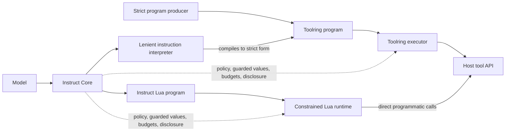
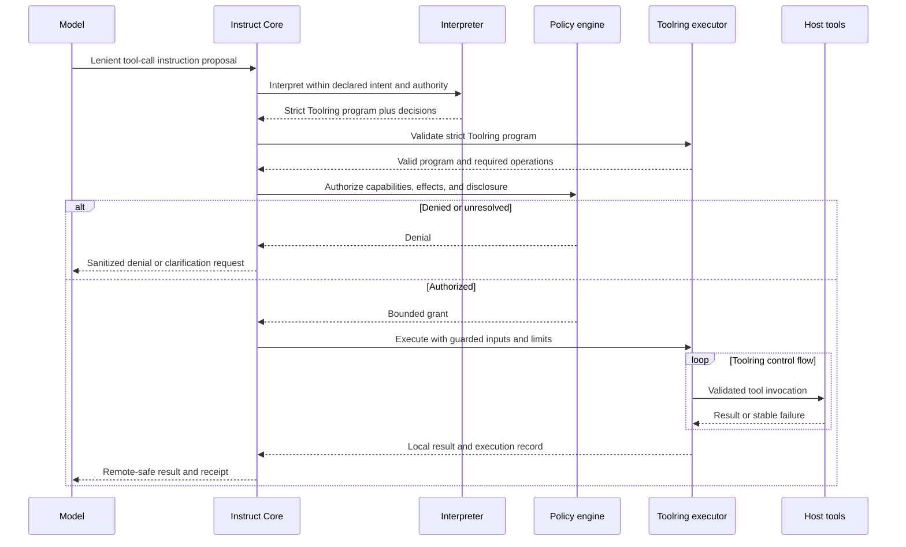
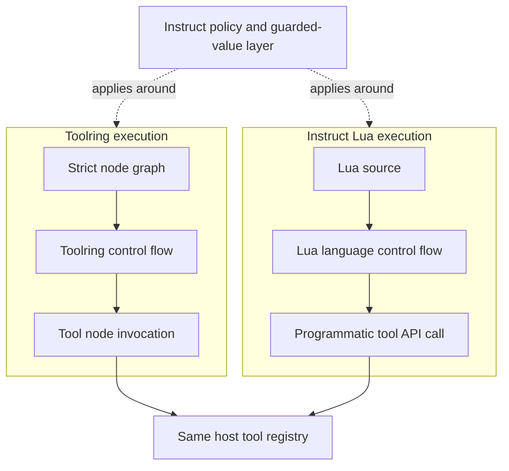

# Instruct Protocol Specification

Status: early draft. This document defines the intended protocol and is not yet a
claim of conformance by the reference implementation.

Instruct is a family of protocols for allowing capable models to affect sensitive
environments without unnecessarily exposing those environments to the model.
It hosts or composes multiple protocols with different scopes:

- **Instruct Core** defines the model-facing protocol, including lenient
  interpretation, the security boundary, authorization, guarded values,
  disclosure, execution lifecycle, and receipts.
- **[Toolring](./TOOLRING.md)** is a strict, independently usable
  tool-orchestration protocol for expressing a complete multi-step operation.
- **Instruct Lua** is a separate programmatic protocol and API for running
  model-supplied Lua in a constrained environment.

Toolring and Instruct Lua can each be used by Instruct, but neither is the syntax of
the other. Toolring is not a lenient model language, and Lua programs are not
Toolring programs. A Toolring host does not have to implement Instruct. When
Toolring or Lua is used inside Instruct, Instruct adds interpretation, policy,
guarding, and disclosure requirements around that execution.

### Protocol relationships



Toolring remains usable along the top path without Instruct. The lower paths show
how Instruct can use Toolring or Lua while keeping their languages and execution
semantics distinct.

## 1. Conventions and terminology

The key words **MUST**, **MUST NOT**, **SHOULD**, **SHOULD NOT**, and **MAY** are to
be interpreted as normative requirements.

- **Model**: the untrusted producer of an instruction.
- **Host**: the trusted software responsible for validation, authorization, and
  execution.
- **Environment**: the tools, data, and sandboxes available to a host.
- **Instruction capsule**: the envelope submitted for execution.
- **Instruction proposal**: a lenient, Instruct-specific model reply that is not
  directly executable.
- **Toolring program**: a strict, validated orchestration graph.
- **Tool**: a host-provided operation with declared inputs, outputs, authority,
  and effects.
- **Capability**: named authority to invoke an operation or class of operations.
- **Effect**: a possible externally observable state change.
- **Grant**: the maximum authority and resource budget available to a run.
- **Guarded value**: a value or local handle accompanied by security metadata.
- **Handle**: an opaque reference to data retained by a trusted environment.
- **Remote**: any destination outside the trusted execution boundary, including
  the model.

## 2. Instruct Core

### 2.1 Goals

Instruct enables a model to request useful work over sensitive data while reducing:

- disclosure of raw and derived sensitive values;
- repeated model/tool round trips;
- accidental authority expansion during interpretation;
- leakage through results, logs, errors, and model context; and
- ambiguity about intended and observed side effects.

Instruct does not assume that model output is correct or benign. Model-generated
instruction proposals, Toolring programs, and Lua programs are hostile input.

### 2.2 Strict execution, lenient interpretation

Instruct exists partly to bridge the mismatch between capable but imperfect model
output and strict execution protocols.

Toolring itself is strict. Instruct MAY accept a more lenient instruction proposal
and interpret, repair, or complete it before producing a Toolring program. This
leniency belongs to Instruct, not Toolring. The resulting Toolring program MUST
satisfy Toolring exactly before it can be executed.

Instruct's interpretation MAY compensate for harmless model-facing variation such
as tool aliases, alternate argument names, omitted defaults, or locally resolvable
references. It MUST NOT guess through security-relevant ambiguity, change material
intent, or expand capabilities, effects, destinations, or budgets.

The host SHOULD record material interpretation decisions and SHOULD make the
resolved strict program available for inspection or audit. Failure to produce one
unambiguous, authorized program MUST result in clarification or denial, not partial
or speculative execution.

#### Tool-call instruction lifecycle



### 2.3 Trust boundary

The host and its policy engine are authoritative. A model, instruction interpreter,
intent resolver, tool, or sandbox MUST NOT grant itself authority.

Before execution, the host MUST:

1. validate the instruction envelope;
2. resolve it to a strict executable representation, if resolution is needed;
3. determine its required capabilities and possible effects;
4. compare those requirements with both its declarations and the active grant;
5. reject the instruction if required authority is undeclared or ungranted; and
6. establish finite resource and disclosure budgets.

The host MUST apply disclosure policy to every value leaving the trusted boundary,
including ordinary results, partial results, events, logs, standard output,
standard error, exception messages, traces, and receipts.

### 2.4 Instruction capsule

An instruction capsule identifies one requested run. It contains at least:

- a protocol version and instruction identifier;
- an instruction kind and human-readable intent;
- declared capabilities and effects;
- a disclosure budget;
- guarded inputs; and
- either an Instruct tool-call proposal, a strict Toolring program, or a program
  for a separately specified programmatic API such as Instruct Lua.

The intent is descriptive. It does not grant authority and MUST NOT override the
machine-readable declarations or host policy.

Unknown protocol versions MUST be rejected unless an explicit compatible-version
rule applies. A host SHOULD preserve or compute a stable digest of the received
capsule before interpretation. If an instruction proposal is compiled to Toolring,
the host SHOULD also digest the resolved Toolring program.

### 2.5 Authorization

Authorization is an intersection, never a union:

```text
effective authority = required authority
                    ∩ declared authority
                    ∩ granted authority
                    ∩ host policy
```

Every operation MUST be permitted by all applicable layers. Missing permission at
any layer is a denial.

A capability names permission to perform an operation. An effect describes a
possible state change, independently of the capability used to produce it. Hosts
MUST authorize both capabilities and effects.

Effects SHOULD state their type, affected resource or resource class, and whether
they are reversible. A broader grant MAY authorize a narrower effect, but a narrow
grant MUST NOT authorize a broader one.

Instruct interpretation MAY repair names, argument shape, or other presentation
ambiguities. It MUST NOT add a capability, effect, disclosure destination, or
resource budget that was not declared and granted.

### 2.6 Guarded values

Every sensitive runtime value MUST be represented as a guarded value. A guard
describes at least:

- sensitivity;
- disclosure labels;
- provenance and contributing source handles;
- transformation history;
- permitted operations and destinations;
- scope and optional expiry; and
- correlation policy.

A guarded value can contain a local value, an opaque handle, or both. Possession of
a handle is not authority to resolve it. A host MUST validate handle scope, expiry,
and applicable policy on every resolution.

#### 2.6.1 Derivation

A value derived from guarded inputs MUST remain guarded. Unless a trusted transform
provides a stronger, explicit guarantee, the derived guard MUST be at least as
restrictive as every contributing guard.

For ordinary composition:

- sensitivity is the highest input sensitivity;
- permitted destinations and operations are their intersections;
- provenance, source handles, labels, and transformation records are preserved;
- expiry is no later than the earliest input expiry; and
- correlation MUST NOT become more persistent.

Merely formatting, summarizing, aggregating, templating, encrypting, encoding, or
passing a value through a model does not declassify it. Declassification MUST be an
explicit trusted operation with recorded guarantees and policy authorization.

#### 2.6.2 Remote representation

When a value crosses the trusted boundary, the host MUST choose a policy-approved
representation such as:

- the value itself;
- an opaque handle;
- a scoped pseudonym;
- a non-sensitive summary; or
- a withheld marker.

Raw values MUST NOT be disclosed unless their guard, active grant, disclosure
budget, and destination policy all permit it. If safe representation is impossible,
the host MUST withhold the value rather than fail open.

### 2.7 Contextual handles and tools

Models often need enough context to reason about sensitive data without receiving
the data itself. A host SHOULD provide opaque handles together with bounded,
non-sensitive descriptions of their type, role, provenance, and permitted uses.

Hosts SHOULD expose contextual tools that operate on these handles locally. Such a
tool MUST enforce the same authorization and guard rules as a tool operating on a
raw value.

### 2.8 Resource budgets

Every run MUST have finite limits appropriate to its execution mechanisms. Limits
may include elapsed time, instruction count, memory, output bytes, tool calls,
iteration count, nesting depth, and remote disclosure bytes.

A child execution MUST NOT receive a budget or authority greater than its parent.
Budget exhaustion MUST terminate or safely divert the affected operation and MUST
NOT cause sensitive diagnostic data to cross the trust boundary.

### 2.9 Events and receipts

A host SHOULD emit ordered operational events sufficient to audit normalization,
authorization, execution, recovery, effects, failure, and completion. Event payloads
MUST contain allowlisted operational metadata only; they are part of the disclosure
surface.

A completion receipt SHOULD contain:

- protocol version and status;
- a digest of the original instruction;
- a digest of the resolved Toolring or Lua program, when one exists;
- sanitized ordered events and aggregate metrics;
- observed effects;
- the remote-safe result; and
- integrity and optional chaining information.

Receipt integrity MUST cover every field whose alteration would change the meaning
of the receipt. The protocol defines receipt fields and their meaning, not a
mandatory wire format. JSON, YAML, CBOR, or another representation MAY be used by
an implementation or interoperability profile, provided it preserves the protocol
semantics without ambiguity.

When a digest, MAC, or signature is computed, the applicable profile MUST define
an unambiguous mapping from the semantic value to bytes. That mapping MUST NOT
depend on map or object member order and MUST reject values it cannot represent
without loss. It MUST also identify the integrity algorithm and all parameters
needed for verification. Implementations MUST use algorithms considered secure for
their purpose and MUST reject algorithms disabled by local security policy.

The core protocol does not mandate one serialization or cryptographic algorithm.
Interoperability requires the producer and verifier to agree on a representation,
canonicalization, and integrity profile. Profiles SHOULD support versioning and
algorithm replacement without changing the meaning of the protected receipt.

An implementation MUST distinguish at least:

- **denied**: validation or authorization prevented execution;
- **failed**: execution began but did not complete successfully; and
- **completed**: the requested execution reached a terminal result.

A completed status does not imply that the result is remotely disclosable.


## 3. Instruct Lua Programmatic Protocol

Instruct Lua is a separate way to express advanced operations. It is not Toolring
syntax, a serialization of a Toolring graph, or a Toolring execution profile.

The distinction is structural:

- a Toolring program describes orchestration using Toolring nodes and edges;
- a Lua program describes computation and control flow using Lua; and
- Instruct can interpret and secure either form using the same tools, grants,
  guarded values, budgets, and disclosure policy.



An implementation MAY translate between representations as a private optimization,
but conformance and observable semantics remain those of the protocol originally
submitted. Such translation MUST NOT make Toolring or Lua features implicitly part
of the other protocol.

### 3.1 Programmatic API

The Lua environment exposes a small, capability-mediated API for reading explicit
inputs, invoking host tools, and returning a result. Tool invocation from Lua is a
programmatic API call. It is not a nested Toolring node or Toolring program.

The API specification MUST define:

- the program entry point and input context;
- conversion between guarded host values and Lua values;
- tool lookup, argument passing, and result conversion;
- synchronous or asynchronous call behavior;
- stable failure values or error codes;
- cancellation and resource accounting; and
- propagation of guards through Lua operations and tool results.

Calls through the Lua API remain subject to Instruct authorization. The program
MUST NOT obtain a capability, tool, value, destination, or budget merely by naming
or constructing it in Lua.

### 3.2 Sandbox boundary

The Lua runtime MUST NOT expose filesystem, network, process, package loading,
clocks, randomness, environment variables, native modules, debug facilities, or
other ambient authority unless each facility is explicitly granted and mediated by
the Instruct host.

Only capsule inputs and explicitly exposed APIs are available to the program. A
child tool call receives no more authority or remaining budget than the Lua run.

Standard output, standard error, exceptions, traces, and API errors are disclosure
surfaces. Sensitive values in them MUST be replaced with safe handles or withheld
markers before leaving the trusted boundary.

### 3.3 Language-level control flow

Lua conditionals, loops, functions, and error handling belong to Lua execution,
not Toolring. Their limits are enforced by the Lua sandbox's instruction, memory,
time, call-depth, output, and tool-call budgets.

Toolring retry, recovery, compensation, parallel, and join semantics do not apply
to Lua code unless the Lua API defines an explicit, separately named equivalent.
Ordinary Lua exception handling MUST NOT be described as Toolring recovery.

## 4. Conformance and open issues

Conformance is assessed separately for:

- Instruct Core hosts;
- Instruct instruction interpreters;
- Toolring executors;
- tools; and
- Instruct Lua runtimes and APIs.

Conformance tests SHOULD include both accepted examples and required rejections.
Security invariants MUST be tested across success, failure, retry, recovery,
compensation, cancellation, and budget exhaustion.

The following matters remain intentionally unsettled in this draft:

- concrete wire encodings, canonicalization profiles, and integrity algorithms;
- a complete schema for capsules, guards, Toolring programs, events, and receipts;
- lexical rules for names, capabilities, effects, and extensions;
- precise scope and correlation semantics for handles and pseudonyms;
- fallback syntax and result compatibility;
- transaction and idempotency contracts for tools;
- parallel scheduling and merge rules;
- recovery behavior for Toolring condition, loop, and parallel nodes;
- the exact Instruct Lua API and guarded-value conversion rules;
- receipt chaining and signature profiles; and
- negotiation of compatible protocol and extension versions.

These issues MUST be resolved before a stable 1.0 specification.
